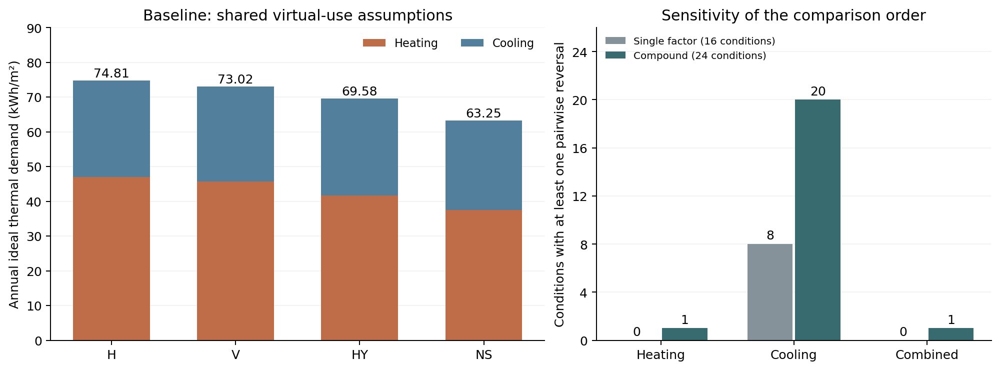

# Building energy sensitivity analysis

Python workflows for generating EnergyPlus models and examining how geometry and
shared operating assumptions affect annual heating and cooling demand. The case
study uses **four drawing-derived energy-station scenarios** in Taiyuan, China.

**Python · EnergyPlus · Computational geometry · Parametric simulation · Sensitivity analysis**

[Methods](docs/METHODS.md) · [Reproduce](docs/REPRODUCING.md) · [Data](data/README.md) · [Citation](CITATION.cff)

## Research question and result

How stable is the comparison between four building scenarios when thermal zoning,
envelope properties and operating inputs change?

The archive contains **170 simulation records**: four baselines, six hybrid
geometry branches, 64 single-factor runs and 96 compound-factor runs. The latter
cover three full 2³ designs, each evaluated across all four scenarios.



*Left: supply-air total heating and cooling demand per conditioned floor area.
Right: tested conditions with at least one pairwise reversal relative to the
baseline, using a 0.01 kWh/m²/year near-tie threshold. H = horizontal,
V = vertical, HY = hybrid, NS = north–south.*

- Baseline combined ideal thermal demand ranges from **63.25 to 74.81 kWh/m²/year**.
- The 16 single-factor conditions preserve the heating and combined-demand order;
  cooling has a pairwise reversal in **8 of 16** conditions.
- The 24 compound conditions produce reversals in **1 heating, 20 cooling and
  1 combined-demand** comparisons. Comparing only the baseline would miss these
  changes.

## Computational workflow

| Step | Implementation |
| --- | --- |
| Floor polygons → thermal model | [Geometry-to-IDF generator](src/energy_model.py): polygon intersections, surface pairing, windows, Kiva foundations and area checks |
| Scenario inputs → simulation runs | [Batch runner](run_simulations.py): checksum verification, parallel execution and per-case logs |
| SQLite outputs → numerical data | [Result extraction](src/results.py): monthly zone loads, actual conditioned areas and annual intensities |
| Numerical data → comparisons | [Sensitivity analysis](src/sensitivity.py): pairwise reversals, near-ties and factorial finite contrasts |
| Results → figures | [Plotting code](src/figures.py): geometry plans, thermal-demand comparisons and compound-condition changes |

## Quick start

Python **3.11 or later**. Numerical reproduction uses the standard library:

```sh
python run_analysis.py --check-models
python -m unittest discover -s tests -v
```

This recomputes 170 annual records from the monthly inputs, checks them against
archived values and verifies model hashes. Tables and `summary.json` are written
to `outputs/analysis/`. [Figure generation, model building and simulation commands](docs/REPRODUCING.md).

## Repository guide

| Location | Responsibility |
| --- | --- |
| [Root Python commands](docs/REPRODUCING.md) | Build models, run simulations, extract SQL results and analyse sensitivity |
| [src/](src/) | Geometry, result extraction, comparisons and plotting |
| [data/](data/README.md) | Case index, monthly loads and geometry inputs |
| [configs/](configs/) | Common model and operating parameters |
| [models/](models/) | 170 original, executed EnergyPlus IDFs |
| [reference/](reference/README.md) | Annual comparison targets, geometry QA, source verification and baseline logs |
| [assets/](assets/) · [docs/](docs/) | Research figures, methods and reproduction instructions |
| [tests/](tests/) | Units, near-ties, factorial contrasts and archived-data regression checks |
| [PROVENANCE.md](PROVENANCE.md) · [source_manifest.json](source_manifest.json) | Source history, identities, weather checksum and engine version |

Generated analyses, rebuilt models and new solver runs go in `outputs/`, ignored
by Git. The original IDFs in `models/` remain reference inputs for rerunning.

## Validation and scope

| Result or artifact | Input and implementation | Verification |
| --- | --- | --- |
| Annual demand for 170 runs | Monthly zone loads → [result calculations](src/results.py) | [Full-precision annual reference](reference/annual_results.csv) |
| Pairwise reversals and factorial contrasts | Case definitions → [sensitivity calculations](src/sensitivity.py) | Analytical contrast tests and archived-data checks |
| Four regenerated baselines | Floor polygons + [parameters](configs/model_parameters.json) → [builder](build_models.py) | Geometry checks and EnergyPlus-object comparison with archived IDFs |
| Four baseline solver reruns | Original IDFs + specified weather → [batch runner](run_simulations.py) | [Recorded rerun verification](reference/validation/baseline_rerun_verification.json) |

These are conditional geometry scenarios with common virtual-use assumptions.
The outputs are **ideal thermal conditioning demand**, including sensible and
latent loads. They do not estimate purchased electricity or establish actual
energy-station savings. The four scenarios have different areas and layouts.

All 170 source IDF/SQL pairs were checked during repository preparation. Four
baseline models were regenerated and rerun with EnergyPlus; their annual metrics
matched the archived values. The runs retain known psychrometric warnings, and
a same-input annual solver-error bound has not been established.
[Verification details and limitations](docs/VALIDATION.md).

## Research record

Ongoing research by **Zihao Lin**, using a 170-run simulation archive.
[Source history and adaptations](PROVENANCE.md) · [Repository citation](CITATION.cff)
· [Dependencies and reuse](LICENSE_NOTES.md).

[Geometry plans and common modelling conditions](docs/METHODS.md#geometry-and-common-conditions).
