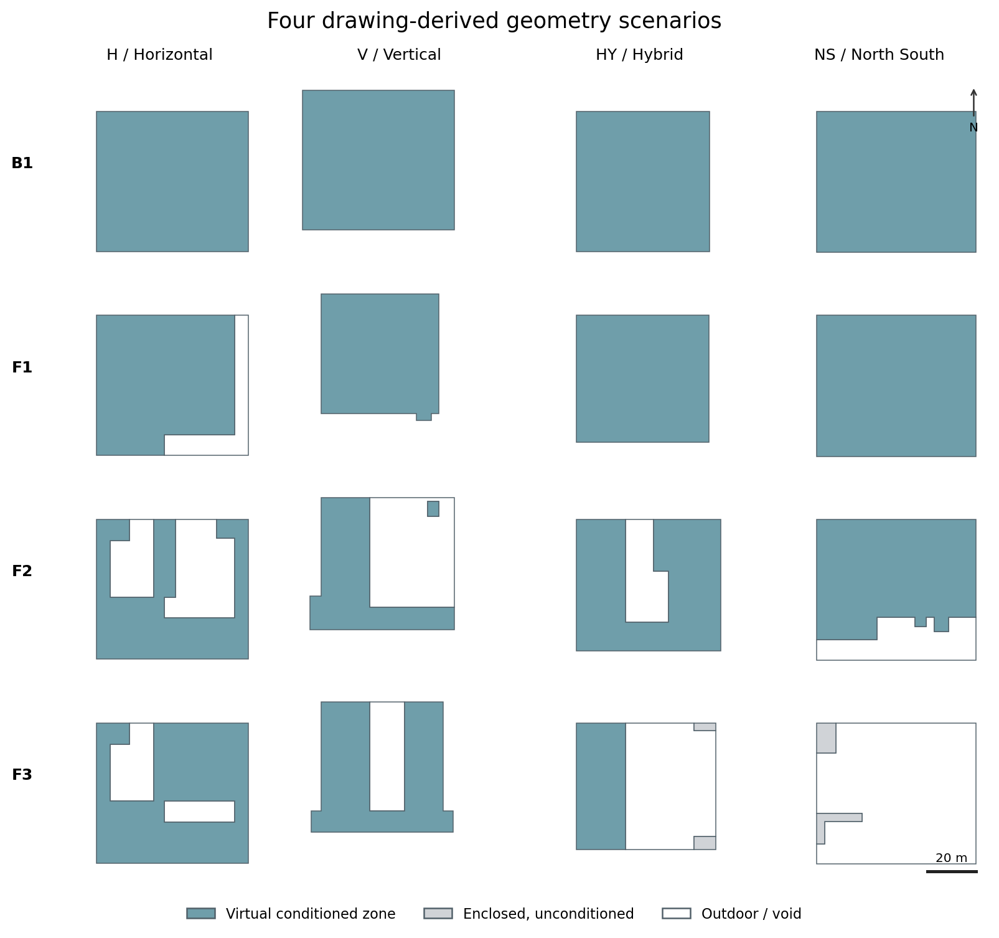

# Building energy sensitivity analysis

Python workflows for generating EnergyPlus models and examining how geometry and
shared operating assumptions affect the comparison of annual heating and cooling
demand. The case study uses **four drawing-derived energy-station scenarios** in
Taiyuan, China.

**Python · EnergyPlus · Computational geometry · Parametric simulation · Sensitivity analysis**

## Research question

How stable is the comparison between four building scenarios when thermal zoning,
envelope properties and operating inputs change?

The archive contains **170 simulation records**: four baselines, six hybrid
geometry branches, 64 single-factor runs and 96 compound-factor runs. The latter
cover three full 2³ designs, each evaluated across all four scenarios.


*Left: supply-air total heating and cooling demand per conditioned floor area.
Right: tested conditions with at least one pairwise reversal relative to the
baseline, using a 0.01 kWh/m²/year near-tie threshold. H = horizontal,
V = vertical, HY = hybrid, NS = north–south.*

## Computational workflow

| Step | Implementation |
| --- | --- |
| Floor polygons → thermal model | [Geometry-to-IDF generator](src/energy_model.py): polygon intersections, surface pairing, windows, Kiva foundations and area checks |
| Scenario inputs → simulation runs | [Batch runner](run_simulations.py): checksum verification, parallel execution and per-case logs |
| SQLite outputs → numerical data | [Result extraction](src/results.py): monthly zone loads, actual conditioned areas and annual intensities |
| Numerical data → comparisons | [Sensitivity analysis](src/sensitivity.py): pairwise reversals, near-ties and factorial finite contrasts |
| Results → figures | [Plotting code](src/figures.py): geometry plans, thermal-demand comparisons and compound-condition changes |

## Quick start

Python **3.11 or later**. Numerical reproduction requires only the standard library:

```sh
python run_analysis.py --check-models
python -m unittest discover -s tests -v
```

This recalculates all 170 annual records from the included monthly data, verifies
the model checksums, and writes tables and a summary to `outputs/analysis/`.

To regenerate the figures and baseline models:

```sh
python -m pip install -r requirements.txt
python run_analysis.py --figures
python build_models.py
```

To rerun the simulations, install **EnergyPlus 26.1.0** and obtain the specified
Taiyuan CSWD weather file. See [reproduction instructions](docs/REPRODUCING.md).

## Selected findings

- Baseline combined ideal thermal demand ranges from **63.25 to 74.81 kWh/m²/year**.
- The 16 single-factor conditions preserve the heating and combined-demand order;
  cooling has a pairwise reversal in **8 of 16** conditions.
- The 24 compound conditions produce reversals in **1 heating, 20 cooling and
  1 combined-demand** comparisons. Comparing only the baseline would miss these
  changes.

[Experiment design and results](docs/METHODS.md) · [Data dictionary](data/README.md)

## Geometry



*Floor polygons at a common scale, with +Y pointing north. Blue denotes virtual
conditioned space; grey denotes enclosed unconditioned space. Models use a 6 m
floor height and scenario-specific conditioned areas.*

## Scope and verification

These are conditional geometry scenarios with common virtual-use assumptions.
The outputs are **ideal thermal conditioning demand**, including sensible and
latent loads. They do not estimate purchased electricity or establish actual
energy-station savings. The four scenarios have different areas and layouts.

All 170 source IDF/SQL pairs were checked during repository preparation. Four
baseline models were regenerated and rerun with EnergyPlus; their annual metrics
matched the archived values. The runs retain known psychrometric warnings, and
a same-input annual solver-error bound has not been established.
[Verification details and limitations](docs/VALIDATION.md).

This repository documents ongoing research. Source history and code adaptations
are recorded in [PROVENANCE.md](PROVENANCE.md).

[Dependencies and reuse](LICENSE_NOTES.md) · [GitHub profile](https://github.com/leolinnnn)
