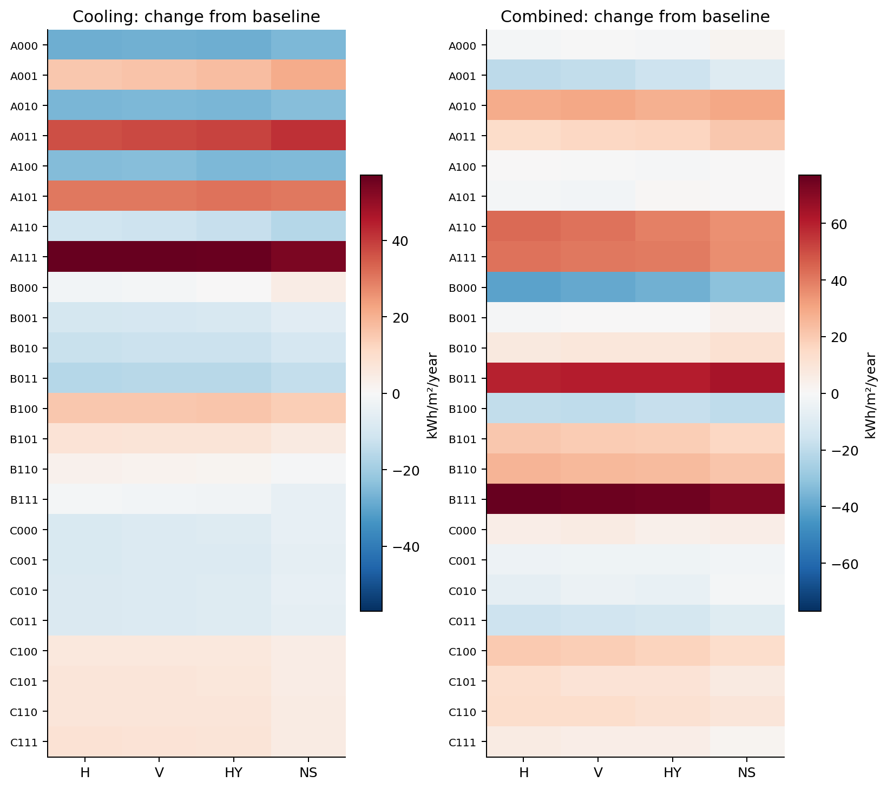

# Experiment design and interpretation

[← README](../README.md)

## Geometry and common conditions

Four conditional scenarios are reconstructed from annotated architectural
drawings: horizontal (H), vertical (V), hybrid (HY) and north–south (NS).
Each includes B1 and F1–F3 with 6 m storey heights. +Y remains north; the NS name
is a scenario label, not an independent rotation experiment.

The model generator constructs one zone per connected enclosed component and
floor category. Outdoor/void regions are excluded from the thermal zones.
Enclosed unconditioned components retain their interzone boundaries. Conditioned
floor areas come from the actual run's SQL `Zones` table, not a common nominal
denominator. No rescaling is used to equalize the four areas.

| Scenario | Conditioned area (m²) | Heating | Cooling | Combined |
| --- | ---: | ---: | ---: | ---: |
| H | 11,588.45 | 46.92 | 27.89 | 74.81 |
| V | 9,623.27 | 45.64 | 27.38 | 73.02 |
| HY | 9,636.54 | 41.64 | 27.94 | 69.58 |
| NS | 10,555.06 | 37.47 | 25.78 | 63.25 |

Thermal metrics are in kWh/m²/year. Full precision is retained in the CSV data.

Common settings include EnergyPlus 26.1.0, Taiyuan 537720 CSWD weather, six zone
timesteps per hour, a 1 mm geometry grid, `FullExterior` solar distribution,
Kiva foundations and IdealLoads systems without capacity limits. B1 is assumed
fully buried. Internal gains and operating schedules are constant throughout
the year; actual station plant and process loads are not modelled.

## Output definition

The outputs are `Zone Ideal Loads Supply Air Total Heating Energy` and
`Zone Ideal Loads Supply Air Total Cooling Energy`, in joules. They represent
sensible plus latent conditioning of supply air. They differ from heat delivered
directly to the zones and from fuel/electricity outputs.
[EnergyPlus output-variable documentation](https://bigladdersoftware.com/epx/docs/26-1/input-output-reference/group-zone-forced-air-units.html#zone-ideal-loads-supply-air-total-heating-energy-j).

For each metric, sum all twelve monthly outputs across the conditioned zones,
divide by **3,600,000 J/kWh**, then divide by that scenario's conditioned area.
The combined metric is the sum of the separately calculated heating and cooling
intensities. The CSWD weather is a common weather dataset; a simulation-calendar
year in SQL does not turn it into observed weather for that year.

## Sensitivity cases

| Parameter | Baseline | Low / high |
| --- | --- | --- |
| Window-to-wall ratio | 0.20 | 0.00 / 0.40 |
| Heating/cooling setpoints (°C) | 20 / 26 | 18 / 28 and 22 / 24 |
| Total internal gains (W/m²) | 8 | 0 / 16 |
| Infiltration (ACH) | 0.20 | 0.10 / 0.50 |
| Outdoor air (L/s/m²) | 0.30 | 0.00 / 0.60 |
| Wall XPS thickness (m) | 0.08 | 0.04 / 0.12 |
| Roof XPS thickness (m) | 0.10 | 0.05 / 0.15 |
| Soil conductivity (W/m/K) | 1.73 | 0.80 / 3.00 |

Each of the sixteen single-factor conditions is applied to all four scenarios
(64 runs). Three compound panels each enumerate all eight low/high combinations:

| Panel | First bit | Second bit | Third bit |
| --- | --- | --- | --- |
| A | Window-to-wall ratio | Setpoint pair | Internal gains |
| B | Window-to-wall ratio | Infiltration | Outdoor air |
| C | Window-to-wall ratio | Wall insulation | Roof insulation |

`0` denotes the low level and `1` the high level. For example, `C010` uses zero
window-to-wall ratio, 0.12 m wall XPS and 0.05 m roof XPS. All other inputs retain
their baseline values. There are 24 common conditions × four scenarios = 96 runs.

Six additional HY-F3 cases cross the west side's outdoor/conditioned interpretation
with the east side's outdoor/unconditioned/conditioned interpretation. Their own
conditioned areas are used. `W1-E0` repeats the baseline geometry as a control;
these six records are not six independent observations. The geometry branches
are not crossed with the 24 compound parameter conditions.

## Pairwise comparisons and finite contrasts

For a pair of scenarios, a reversal requires opposite signs of the baseline and
changed-condition differences, with both absolute gaps exceeding **0.01
kWh/m²/year**. Smaller gaps are labelled near-ties. This is a descriptive threshold,
not a confidence interval or a proven numerical-error tolerance.

Cooling reversals occur in 8/16 single-factor and 20/24 compound conditions.
Heating and combined demand each reverse in one compound condition (`C010`,
H versus V). All four cooling outputs are zero in `A000`; arbitrary sorting of
these tied values is not counted as evidence of a reversal.

The factorial code calculates average high-minus-low contrasts and two-/three-way
finite differences over the eight corners of each panel. These are deterministic
scenario contrasts, not significance tests or global sensitivity indices.

*Changes are relative to each scenario's own baseline. Each panel uses its own
colour scale, in kWh/m²/year. The code regenerates the figure from the CSV data.*

Results apply to the tested geometry interpretations and input levels. Their
ordering does not identify a universally optimal energy-station form or isolate
a causal effect of shape from area, zoning and layout.
